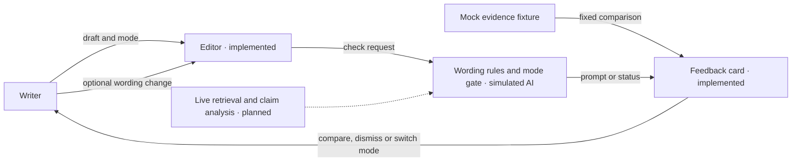
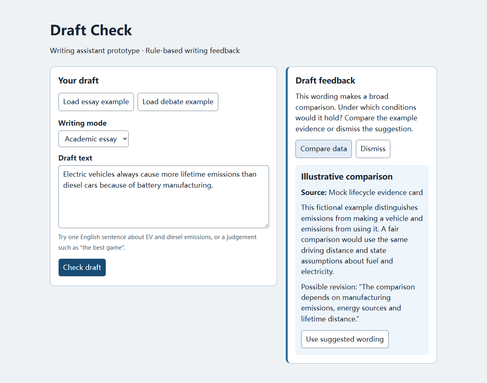
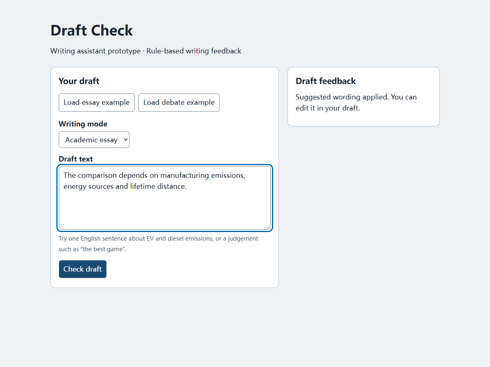
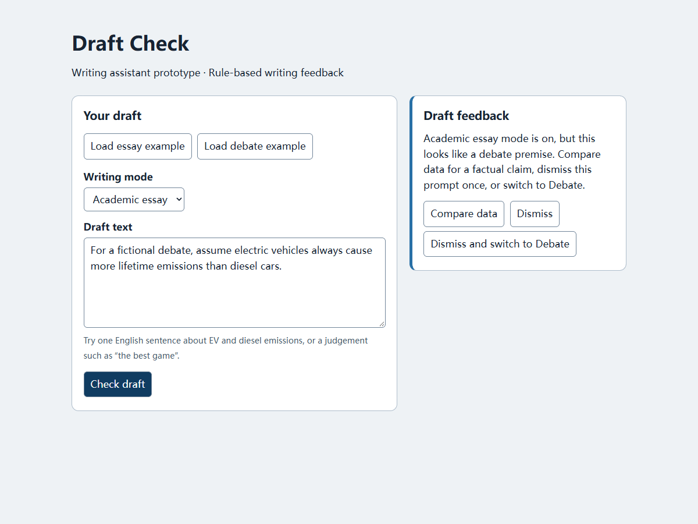
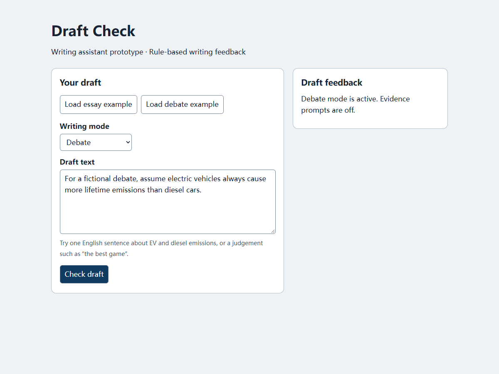
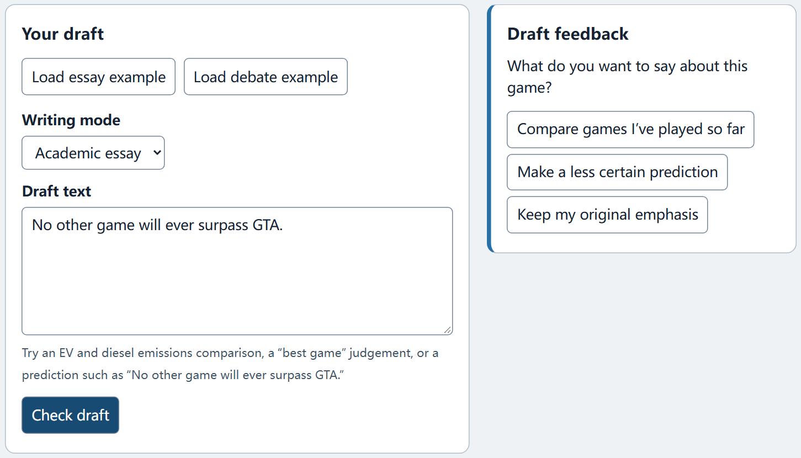
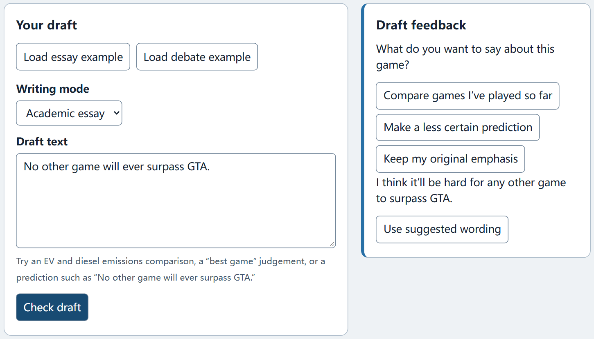

# System and interaction frames

## System diagram

The simulated decision runs on a check request. Debate mode suppresses evidence prompts. The evidence fixture is a fixed local example.

## Essay review

1. Load essay example → Check draft → Side panel asks about conditions for a broad comparison.
2. Compare data → Panel opens the mock evidence and a possible revision.
3. Use suggested wording → Editor applies the revision on request. Dismiss → Editor keeps the original.

## Clarifying a debate premise

1. Load debate example → Check draft in Academic essay mode → Panel asks because debate wording conflicts with the selected mode. The writer can compare data or dismiss this prompt once.
2. Dismiss and switch to Debate → Panel closes and the mode changes.
3. Check draft again → Status confirms that evidence prompts are off and the draft remains intact.

## Choosing the intent of a GTA prediction

